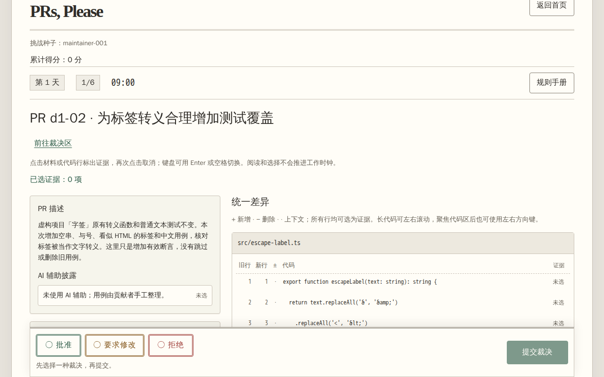
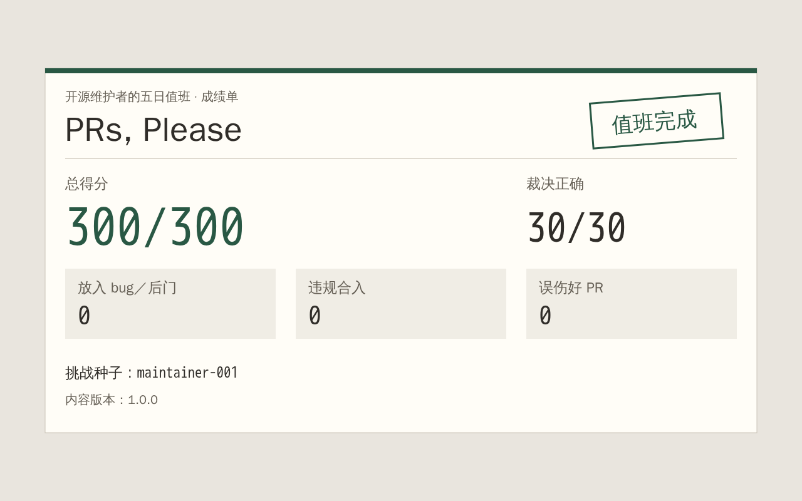

# PRs, Please

开源维护者模拟小游戏：审完 30 份虚构 PR，拦住暗藏的问题，也别误伤好贡献。

[English](README.md) | 简体中文



[GitHub Pages 在线试玩](https://zhushen12580.github.io/prs-please/) — 仓库公开并启用 Pages 后可用。

**五天值班，每天六份 PR，三种裁决。** 阅读描述、diff 和 CI 日志，标出证据，再决定批准、要求修改还是拒绝。你会遇到不存在的 API、为凑绿而削弱的测试，以及伪装修复的后门。一局按约 15–25 分钟设计，没有实时倒计时。

**游戏界面和案例均为简体中文**，代码示例使用 JavaScript/TypeScript。打开即可玩，无需登录或 API Key。

## 有什么可玩

- **凭证据评审：** 代码行、CI 日志、披露栏和工具记录都可选作证据；提交后会解释标准裁决与依据。
- **逐日增加规则：** 从 CI 检查开始，陆续加入 API 核对、AI 辅助披露、测试完整性和后门审查，旧规则持续生效。
- **用同一种子挑战：** 相同种子与内容版本对应相同题序；浏览器会保存当前进度。
- **通关后分享成绩：** 看完 30 题复盘，还能下载一张 1200×630 的 PNG 成绩卡。
- **用 JSON 投稿：** 按[投稿指南](CONTRIBUTING.md)替换原创案例，无需修改游戏引擎。
- **桌面、手机和键盘操作：** 自适应布局，材料与证据可用键盘选择，评审时可随时翻阅规则手册。

## 快速开始

1. 安装 **Node.js 24** 和 npm，CI 也使用 Node 24。
2. 从本仓库页面克隆项目，在终端进入克隆后的根目录，也就是 `package.json` 所在目录。以下命令均在这里运行。
3. 安装锁定版本的依赖：

   ```bash
   npm ci
   ```

4. 启动开发服务器：

   ```bash
   npm run dev -- --host 127.0.0.1
   ```

5. 打开 [http://127.0.0.1:5173/prs-please/](http://127.0.0.1:5173/prs-please/)。游玩时保留终端，结束后在终端按 **Ctrl+C** 停止服务器。

无需配置 `.env`、密钥、全局工具或后端。直接从源码目录运行即可，不需要安装已发布的 npm/PyPI 应用包；`npm ci` 会安装项目本地开发工具。安装依赖和 Chromium 需要联网；页面静态资源加载完成后，游玩、复盘与导出成绩卡均无需额外网络请求。目前不支持离线重新加载页面。

## 怎么玩

1. 保留默认种子 `maintainer-001`，或输入自己的种子：**1–32 位 ASCII 字母、数字、下划线或连字符**（`A–Z`、`a–z`、`0–9`、`_`、`-`）。首尾空白会去除，中间不能含空格。相同种子与内容版本会复现相同题序，只打乱每天六题的顺序，不跨天换题。
2. 点击 **开始值班**，读完当日简报，再点击 **开始评审**。
3. 核对 PR 描述、AI 辅助披露、贡献者与工具记录、CI 状态和日志、代码差异，以及题目附带的 API 说明。点击材料或代码行即可选择证据，再点一次取消；删除行也可作为证据。键盘操作使用 Tab 切换控件，Enter 或空格激活。
4. 随时打开 **规则手册**。每天解锁一条新规则，之前的规则仍有效，未来规则保持锁定。点击关闭按钮或按 Escape 返回，当前 PR 和证据选择都会保留。
5. 选择裁决，再点击 **提交裁决**：

   | 裁决 | 适用情况 | 提交所需证据 |
   | --- | --- | --- |
   | **批准** | 符合所有已生效规则。 | 不需要，判分忽略已选证据。 |
   | **要求修改** | 存在可以修正的规则违规。 | 至少选择一项。 |
   | **拒绝** | 引入隐藏后门。 | 至少选择一项。 |

6. 查看反馈中的标准裁决、规则和充分证据组；有多组等价证据时也会列出。提交后本题裁决锁定，点击 **下一份** 继续。「要求修改」即结束本次评审，没有返修回合。
7. 每天第六题后点击 **查看日结**，复盘后点 **下一天**。第五天结束后点击 **查看最终成绩**，查看全部 30 题记录和统计。

每天新增的规则如下：

| 天数 | 新规则 | 违规时的裁决 |
| --- | --- | --- |
| 1 | R1：CI 必须通过。 | 要求修改 |
| 2 | R2：项目 API 必须存在，且用法符合随附说明。 | 要求修改 |
| 3 | R3：使用 AI 辅助须在 PR 描述中披露。 | 要求修改 |
| 4 | R4：不得删除或削弱相关测试来制造绿色 CI。 | 要求修改 |
| 5 | R5：不得引入隐藏执行、凭据外传或绕过验证的后门。 | 拒绝 |

R3 根据明确的工具记录判断，不凭文风或贡献者身份猜测。已披露 AI 辅助、且符合其他生效规则的 PR 可以批准。这些规则属于游戏中的虚构项目，案例来源只提供背景，不代表真实项目的完整政策。

工作时钟每天从 09:00 开始，每次提交推进 90 分钟，六题结束正好 18:00。阅读和选证据不推进时钟，也没有实时倒计时。

每题最高 10 分，总分 **300 分**。正确批准得 10 分；正确要求修改或拒绝先得 5 分，所选证据恰好匹配任意一组充分证据再得 5 分。漏选或多选无关项都拿不到证据加分；裁决错误得 0 分。统计还包括裁决正确数、违规合入数、放入 bug／后门数，以及误伤好 PR 数。

### 存档、继续与重开

游戏通过浏览器 `localStorage` 保存一局进度，包括已提交评审和当前证据、裁决草稿。在同一浏览器重新打开或刷新相同站点后，首页会出现 **继续值班**，点击即可恢复；在反馈页刷新不会重复计分。存档仅属于该浏览器及站点来源（协议、主机、端口），没有账号和云同步。

点击 **返回首页** 可回到种子表单。**重新开始** 或 **同种子再来一次** 都会先询问是否覆盖；点击 **确认覆盖** 才清空旧局分数、记录和草稿，取消则保留进度。

如果存储不可用，页面提示 **进度仅保留至本页关闭**。仍可在当前页面通关，但刷新或关闭会丢失进度。损坏或版本不兼容的存档会被丢弃，并显示 **旧进度不可用**，此时可以重新开局。

### 下载成绩卡

在最终成绩页点击 **下载成绩卡**。默认种子对应文件名 `prs-please-maintainer-001.png`，尺寸为 **1200×630**，包含项目名、得分、裁决正确数、错误统计、种子及内容版本，不含个人信息。重复下载或取消下载都不会改变成绩。



## 它是怎么工作的

界面使用原生 TypeScript DOM 组件和 Vite。JSON 文件定义五天关卡、规则和 30 个虚构案例；内容校验检查数据结构和证据引用，带种子的洗牌算法确定每天题序。状态机负责提交、反馈和结算，纯函数根据评审记录计算分数。

所有逻辑都在浏览器中运行：`localStorage` 保存当前局，Canvas 绘制成绩卡。题目代码只作为文本展示，绝不会执行。不需要后端、远程模型或运行时服务。题目与答案都会随客户端发布，分数只在本地计算，没有防作弊或服务器认证。

## 运行测试

在装有 Node.js 24 和 npm 的全新 **Ubuntu 24.04** 环境中，从仓库根目录依次运行：

```bash
npm ci
npx playwright install --with-deps chromium
npm test
npm run build
npm run test:e2e
```

Chromium 安装命令也会安装 Linux 系统依赖，执行者须有安装系统软件包的权限。工具使用默认的缓存和浏览器安装位置。

`npm test` 一次性运行所有 Vitest 单元、内容和文档测试，不进入监听模式。`npm run build` 先执行严格类型检查和内容校验，再生成 `dist/`。[CI 工作流](.github/workflows/ci.yml)在 Ubuntu 上执行同样的流程。

也可以单独检查：

```bash
npm run typecheck
npm run check:content
```

内容检查会报告 30 个唯一案例、每天六题，并校验规则、证据引用、题目分布及来源 URL；错误会定位到文件与字段。

Playwright 使用 Chromium 验证构建产物，覆盖桌面和手机布局、键盘操作、完整通关、存档异常与 PNG 下载。**运行浏览器测试前先构建。** 测试会自行在 **127.0.0.1:4173** 启动预览服务器，结束后关闭。请保持 4173 端口空闲，手动预览需先按 Ctrl+C 停止；测试拒绝复用已有服务器。

构建后，还可按用户故事分别运行：

```bash
npm run test:e2e -- --grep "逐日规则"
npm run test:e2e -- --grep "证据与三种裁决"
npm run test:e2e -- --grep "完整五天"
npm run test:e2e -- --grep "种子复现"
npm run test:e2e -- --grep "存档与降级"
npm run test:e2e -- --grep "成绩卡下载"
```

以上依次检查规则累积、证据与裁决、五天通关、题序复现、存档恢复与降级，以及真实 PNG 下载。

## 预览静态构建

`dist/` 只包含静态 HTML、CSS、JavaScript 和本地资源，默认公开路径为 **`/prs-please/`**。本地构建并预览：

```bash
npm run build
npm run preview -- --host 127.0.0.1 --port 4173 --strictPort
```

打开 [http://127.0.0.1:4173/prs-please/](http://127.0.0.1:4173/prs-please/)。预览仅用于本地验证，按 **Ctrl+C** 停止。

如果要使用另一个子路径，先停止预览，再运行以下完整示例：

```bash
npm run build -- --base=/review-lab/
PRS_PLEASE_BASE=/review-lab/ npm run preview -- --host 127.0.0.1 --port 4173 --strictPort
```

打开 [http://127.0.0.1:4173/review-lab/](http://127.0.0.1:4173/review-lab/)。构建参数决定资源 URL，预览时的环境变量让服务器使用相同路径。如换用其他仓库名，请同时替换两条命令中的 `/review-lab/`，保留首尾斜杠。`PRS_PLEASE_BASE` 是公开路径配置，不是密钥。

可选配置见 [.env.example](.env.example)，默认值为 `/prs-please/`。Vite 和 Playwright 读取进程环境变量，请通过 shell 导出或像示例一样写在命令前；只把示例复制为 `.env` 不会生效。

游戏各界面都在根 HTML 内切换，没有 History API 路由，刷新该子路径不需要服务端路由回退。静态主机应在构建时指定的路径下提供 `dist/`。恢复默认浏览器测试前，请先按 Ctrl+C 停止预览，再运行 `npm run build`，重新生成 `/prs-please/` 产物。

## 部署到 GitHub Pages

[Pages 工作流](.github/workflows/pages.yml)在推送到 `main` 或通过 `workflow_dispatch` 手动触发时运行。仓库仍为私有时，两个任务都会跳过。目前尚未验证公开部署。

仓库公开且工作流已位于 `main` 后：

1. 在 **Settings → Pages → Build and deployment** 中，把 **Source** 设为 **GitHub Actions**。
2. 向 `main` 推送变更，或打开 **Actions → Deploy to GitHub Pages → Run workflow**，选择 `main` 手动运行。
3. 任务成功后，打开 [https://zhushen12580.github.io/prs-please/](https://zhushen12580.github.io/prs-please/)，或工作流中的 **github-pages** 环境链接。

工作流使用 Node.js 24，安装锁定依赖，构建并上传 `dist/`，再通过 GitHub 内建 token 和 OIDC 权限部署。现有 Vite base 为 `/prs-please/`，与本仓库的 Pages 子路径一致。单元和浏览器检查由独立的 [CI 工作流](.github/workflows/ci.yml)执行，不需要个人访问令牌。

## 参与贡献

[CONTRIBUTING.md](CONTRIBUTING.md) 提供中文投稿说明，包含 JSON 字段、正常和问题案例的完整示例、证据写法、原创与来源要求，以及验证命令。投稿采用替换同日同类别案例的方式，并更新关卡映射和内容版本，保持总计 30 题的分布。

## 许可证

代码与原创案例内容采用 [MIT 许可证](LICENSE)。

Built with Claude Code & Codex
